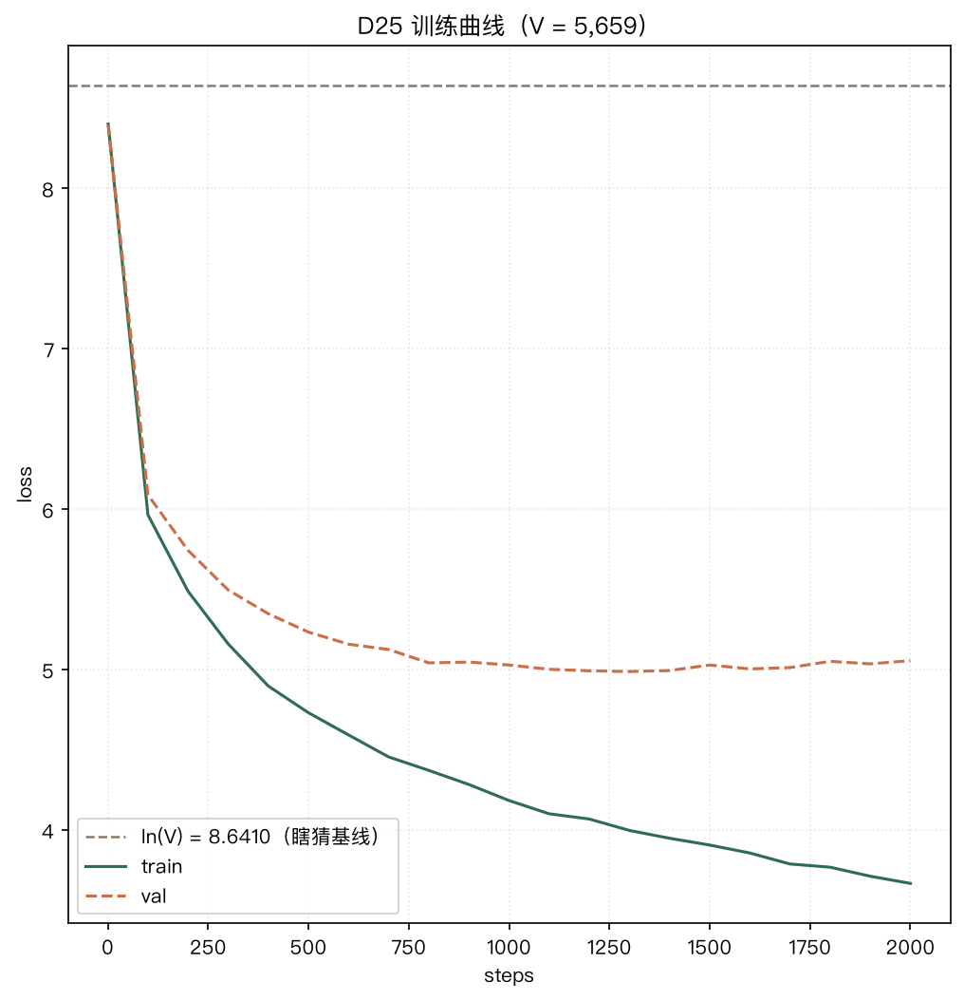

# P1 · 中文迷你 GPT（字符级）

**从零手写的字符级 GPT**：在 **7,000 首全唐诗**（564,784 字）上训练一个 **1.14M 参数**的迷你 Transformer —— 笔记本 **约 3 分钟**（含评估）跑完 2,000 步，初始 loss 精确落在理论值 `ln(V)` 上，生成的文本能对齐《全唐诗》的版式。



---

## 结果

| 指标 | 值 |
|---|---|
| 初始 loss（训练 **0** 步的体检） | **8.6931** ≈ `ln(V)` = 8.6410 ✅ |
| 训练 loss（2,000 步） | **3.6583** |
| 验证 loss（2,000 步） | **5.0657** |
| 困惑度 PPL | 起点 **5,962** → 训练 **38.8** / 验证 **158.5** |

**口径**：V = **5,659**（含 `<unk>`）· batch **32** × block_size **128** · AdamW · lr **1e-3** · **2,000** 步（≈ 820 万 token，训练集约 **16 遍**）· seed **131** · 设备 Apple MPS。

> ⚠️ **不同词表的 loss 不能直接比** —— 起点 `ln V` 本来就不同。要横向比请换算成 `PPL = exp(loss)`，或比"**比自己的 `ln V` 低了多少**"。

**读图**：验证 loss 在 **≈1,200 步触底（4.9759）**，之后**缓慢上翘**，而训练 loss 仍在下降 —— 这是**过拟合**（1.14M 参数 vs 31 万字训练集），不是"还在学"。若按"取验证最优"早停，可白拿 **0.09**。

---

## 快速开始

> 以下命令都在**仓库根目录**执行（本机开发时根目录 = `Code/`）。

```bash
# 1. 环境（Python 3.13）
pip install -r requirements.txt

# 2. 语料 —— 仓库里已带 train.bin / val.bin / vocab.json，可直接跳到第 3 步；
#    要从零重建（需联网，约 1 分钟）：
python W4/tools/download_tangshi.py     # 拉 chinese-poetry 的 58 个唐诗分片（断点续传）
python W4/d22_zh_corpus.py             # 清洗 → corpus.txt / vocab.json / {train,val}_ids.txt
python W4/P1/data.py                   # → train.bin / val.bin（幂等：已存在就跳过）

# 3. 训练 —— MPS 约 3 分钟 / CPU 约 6 分钟（含每 100 步的评估）
python W4/P1/train.py

# 4. 生成
python W4/P1/generate.py
```

**每一步的预期输出**（跑对了你会看到这些）：

| 步骤 | 预期 |
|---|---|
| 语料（可跳过） | `d22_zh_corpus.py`：**7000 首 → 564,784 字符** · vocab **5,658 + 1** · train/val **508,305 / 56,479**；<br>`data.py`：`文件 train.bin 有 508305 字符.` / `文件 val.bin 有 56479 字符.`，随后 `torch.Size([32, 128]) torch.Size([32, 128])` |
| `python W4/P1/train.py` | `[4/4] 初始 loss = 8.69…, ln_v = 8.6410`（两道断言通过）→ 每 100 步一行 train/val → 结尾 `✅ D25 通过`，并生成 `out/ckpt.pt` 与 `out/loss_curve.png` |
| `python W4/P1/generate.py` | 三组 `=== T = 0.5 / 1.0 / 1.5 ===`，接着三组 `=== top_k = … ===`，每组是一段古体诗 |

---

## 项目结构

```
W4/
├── d22_zh_corpus.py            语料清洗 + 词表 + train/val 切分
├── tools/
│   └── download_tangshi.py     从 chinese-poetry 下载唐诗分片（断点续传）
└── P1/                         ← 本文件所在目录
    ├── config.py               超参集中定义（唯一来源）
    ├── data.py                 语料 ↔ token id（prepare 转 .bin / get_batch 取批）
    ├── model.py                模型定义（SelfAttention / FeedForward / GPTBlock / MiniGPT）
    ├── train.py                训练入口（含初始 loss 体检 + loss 曲线落盘）
    ├── generate.py             采样生成（temperature / top-k）
    ├── requirements.txt        依赖（可复现环境）
    ├── data/                   corpus.txt · vocab.json · train.bin · val.bin
    └── out/                    loss_curve.png · ckpt.pt（权重不入库，重跑即可生成）
```

---

## 数据

| 项 | 值 |
|---|---|
| 来源 | chinese-poetry（公版）· 全唐诗 `poet.tang.*` 取前 7,000 首 |
| 规模 | **564,784** 字符 |
| 词表 | **5,659**（5,658 字 + `<unk>`），**只用训练集构建** |
| 训练 / 验证 | **508,305 / 56,479** 字符（前 90% 确定性切分） |
| 说明 | 语料为**繁体**（原样保留，未转简）· **字符级**（单字为基本单位，不用 BPE） |

---

## 模型

| 项 | 值 |
|---|---|
| 结构 | token emb + **可学习位置编码** → 2 × GPTBlock（**单头注意力**，Pre-LN + 残差）→ final LN → lm_head（**权重共享** `head.weight = tok.weight`） |
| n_embd / n_layer / block_size | **128 / 2 / 128** |
| 参数量 | **1,136,512**（1.14M，其中 FFN 占 **66.6%**） |

手算参照：`V×C + T×C + N×(4C² + 8C² + 5C + 4C) + 2C = 724,352 + 16,384 + 395,520 + 256`。

---

## 生成样例

`temperature = 0.5`、`top-k = 20`、起始串 `\n`：

```
今日南山別，何處向西山。
雜曲歌辭湘陽曲
李端
湘水西流水，湘水水流流。
月明湘潭水，風裏憶江中。
別有三十二首二
王維
一朝朝日上，萬里春風煙。
```

它学会了《全唐诗》的**版式**：`标题 ⏎ 作者 ⏎ 正文`，还写对了**真实诗人名**（李端、王維）。

> ⚠️ 这是**一次抽样**，不能据此断言"T = 0.5 整体最好" —— 换个 seed 会变（温度低时有时会退化成复读），要下结论得多次采样取指标均值。

---

## 已知局限

诚实写到具体指标上：

- **过拟合**：验证 loss 在 ≈1,200 步触底后**上翘**（4.9759 → 5.0657），而训练 loss 仍在降 —— 没做早停 / dropout / 权重衰减。
- **模型小**：**1.14M** 参数、**2** 层、**单头**注意力（多头只学了原理、未实现）⇒ 它记住的是**格式与局部搭配**，不是"意思"。
- **语料有限**：只 **7,000 首**唐诗（56 万字）、**繁体**、无任何数据增强；词表也只为这一份语料构建。
- **训练侧简化**：无学习率调度、无梯度裁剪、无早停；只在 Apple MPS 上验证过（CPU 可跑，约慢 2.4 倍）。
- **生成不可控**：没有 prompt 约定（起始串就用 `\n`），**不能指定**"写一首送别诗"。
